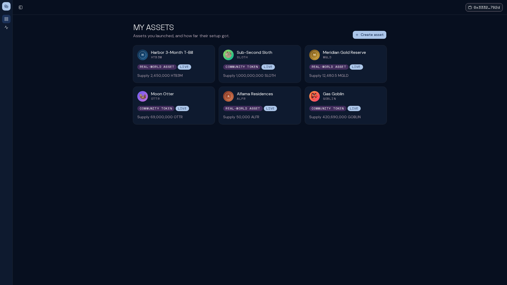

# Arc Asset Issuer

Launch and manage a token on Arc Testnet, then transfer it to other test networks with [CCTP for non-USDC assets](https://developers.circle.com/cctp/expanded-assets). This [Next.js](https://nextjs.org/docs) sample uses [Supabase](https://supabase.com/docs) and a browser wallet to demonstrate token deployment, minting, and cross-chain transfers. Choose a community token or a real-world asset demo token.



## Table of Contents

- [Features](#features)
- [Prerequisites](#prerequisites)
- [Getting Started](#getting-started)
- [How It Works](#how-it-works)
- [Networks](#networks)
- [Environment Variables](#environment-variables)
- [User Accounts](#user-accounts)
- [Available Scripts](#available-scripts)
- [Testing](#testing)
- [Security & Usage Model](#security--usage-model)
- [Known Testnet Limitations](#known-testnet-limitations)
- [Legal](#legal)

## Features

- **Launch an asset** — Set its name, symbol, decimals, and image. Real-world asset demos also include issuer details and a supporting-document link.
- **Mint tokens** — The issuer creates new supply on Arc Testnet.
- **Enable networks** — Deploy the token on a destination network and configure its CCTP connection.
- **Transfer tokens** — Send between Arc and an enabled network, with progress tracking and a retry option for failed delivery.
- **Track activity** — View assets, balances, setup progress, mints, and transfers. Interrupted setup can be resumed.

## Prerequisites

- **Node.js v22+** — Install via [nvm](https://github.com/nvm-sh/nvm) (`nvm use` will read the `.nvmrc` file)
- **Docker Desktop** — required to run Supabase locally. [Install Docker Desktop](https://www.docker.com/products/docker-desktop/)
- **A browser wallet** — such as [MetaMask](https://metamask.io/), funded with testnet USDC from the [Circle faucet](https://faucet.circle.com)
  - To enable a network or send from it, also the gas token of that network (see [Networks](#networks))
  - If your wallet already has Arc Testnet with the old `rpc.testnet.arc.network` RPC, change it to `https://rpc.testnet.arc.io`. Arc moved to `arc.io` and the old address no longer resolves

## Getting Started

1. Clone the repository and install dependencies:

   ```bash
   git clone git@github.com:circlefin/arc-asset-issuer.git
   cd arc-asset-issuer
   npm install
   ```

2. Start the local Supabase instance (requires Docker Desktop running):

   ```bash
   npm run db:start
   ```

   On first start, Supabase creates the local database and applies the migrations in `supabase/migrations`. The output shows the Supabase URL and API keys needed in the next step. Run `npm run db:status` to see them again.

3. Set up environment variables:

   ```bash
   cp .env.example .env.local
   ```

   Fill in the three Supabase values from the previous step. See [Environment Variables](#environment-variables) for the remaining settings.

4. Start the development server:

   ```bash
   npm run dev
   ```

   The app will be available at `http://localhost:3000`. Open it at `localhost`, not `127.0.0.1`: wallet sign-in only accepts the URLs allowed in `supabase/config.toml`.

## How It Works

1. Connect a browser wallet and sign a message to sign in through Supabase.
2. Review the token settings and launch the asset on Arc Testnet. The app deploys an ERC-20 contract and sets up its CCTP connection.
3. Mint tokens as the issuer. To transfer them across chains, enable a destination network first; this requires four setup transactions paid in that network's gas token.
4. Transfer tokens with CCTP: tokens are burned on the source chain and minted on the destination. Transfers use standard finality, with forwarding where supported and manual completion for recovery.

The app uses [wagmi](https://wagmi.sh/) and [viem](https://viem.sh/) to call CCTP contracts and APIs directly. [Hardhat](https://hardhat.org/) builds the [OpenZeppelin](https://www.openzeppelin.com/contracts)-based contracts. Supabase stores asset metadata and progress; images are stored in Supabase Storage.

## Networks

New supply is issued on Arc Testnet. Transfers go between Arc and an enabled network; direct transfers between two destination networks are unsupported. Fund your wallet with each network's gas token before using it.

| Network | Chain ID in the app | CCTP domain | Gas token | Faucet |
| --- | --- | --- | --- | --- |
| Arc Testnet (hub) | `arc-testnet` | 26 | USDC | [Circle faucet](https://faucet.circle.com) |
| Ethereum Sepolia | `ethereum-sepolia` | 0 | ETH | [Google Cloud faucet](https://cloud.google.com/application/web3/faucet/ethereum/sepolia) |
| Avalanche Fuji | `avalanche-fuji` | 1 | AVAX | [Core faucet](https://core.app/tools/testnet-faucet/?subnet=c&token=c) |
| OP Sepolia | `op-sepolia` | 2 | ETH | [Superchain faucet](https://console.optimism.io/faucet) |
| Arbitrum Sepolia | `arbitrum-sepolia` | 3 | ETH | [Alchemy faucet](https://www.alchemy.com/faucets/arbitrum-sepolia) |
| Base Sepolia | `base-sepolia` | 6 | ETH | [Base faucets](https://docs.base.org/base-chain/tools/network-faucets) |
| Polygon PoS Amoy | `polygon-amoy` | 7 | POL | [Polygon faucet](https://faucet.polygon.technology) |

Arc, Ethereum Sepolia, and Base Sepolia are marked as tested onchain in [lib/chains.ts](lib/chains.ts). The other four networks are configured but marked "Not yet tested" in the app.

Public RPCs are configured by default. If requests are rate limited, set an optional RPC override below. Recovery searches read recent events, so older transfers may need an RPC with more history.

## Environment Variables

Only the three Supabase values are required to run the app. RPC overrides and test keys are optional. Copy [.env.example](.env.example) to `.env.local`:

```bash
# Supabase
NEXT_PUBLIC_SUPABASE_URL=
NEXT_PUBLIC_SUPABASE_PUBLISHABLE_KEY=
SUPABASE_SECRET_KEY=

# Optional public RPC overrides, one per chain. Unset, each chain uses its default RPC. Not secret.
NEXT_PUBLIC_RPC_ARC_TESTNET=
NEXT_PUBLIC_RPC_ETHEREUM_SEPOLIA=
NEXT_PUBLIC_RPC_AVALANCHE_FUJI=
NEXT_PUBLIC_RPC_OP_SEPOLIA=
NEXT_PUBLIC_RPC_ARBITRUM_SEPOLIA=
NEXT_PUBLIC_RPC_BASE_SEPOLIA=
NEXT_PUBLIC_RPC_POLYGON_AMOY=

# Testnet tests only (npm run test:testnet). A throwaway key funded with Arc Testnet USDC, and with
# each destination's gas token for the transfer tests. Never used by the app.
DEV_PRIVATE_KEY=
# Comma-separated chain IDs the transfer tests go to and back from. Defaults to ethereum-sepolia.
TESTNET_DESTINATIONS=
```

| Variable | Scope | Purpose |
| --- | --- | --- |
| `NEXT_PUBLIC_SUPABASE_URL` | Public | Local Supabase API URL (from `npm run db:status`). |
| `NEXT_PUBLIC_SUPABASE_PUBLISHABLE_KEY` | Public | Local Supabase publishable key (from `npm run db:status`). |
| `SUPABASE_SECRET_KEY` | Server-side | Local Supabase secret key for privileged writes (from `npm run db:status`). |
| `NEXT_PUBLIC_RPC_<CHAIN>` | Public, optional | RPC URL that replaces a chain's default one: `NEXT_PUBLIC_RPC_ARC_TESTNET`, `_ETHEREUM_SEPOLIA`, `_AVALANCHE_FUJI`, `_OP_SEPOLIA`, `_ARBITRUM_SEPOLIA`, `_BASE_SEPOLIA` or `_POLYGON_AMOY`. Leave unset to use the default. An override must support the event query windows in [lib/chains.ts](lib/chains.ts): 10,000 blocks on Arc, 200 on Base, 100 on Avalanche and Polygon, and 1,000 on the other networks. Browsers send requests to it, so don't put an API key you need to keep private in the URL. |
| `DEV_PRIVATE_KEY` | Tests only | Private key of a throwaway wallet funded with [Arc Testnet USDC](https://faucet.circle.com), used by `npm run test:testnet` to launch real tokens. The transfer tests also need each destination's gas token. Never read by the app. |
| `TESTNET_DESTINATIONS` | Tests only, optional | Comma-separated chain IDs from [Networks](#networks) that the transfer tests send to and back from, such as `ethereum-sepolia,base-sepolia`. Defaults to `ethereum-sepolia`. |

## User Accounts

There's no sign-up. Connect a browser wallet and sign a message to prove it's yours. Signing is free and sends no transaction. The wallet that launches an asset is its issuer, and only the issuer can mint it. Any wallet that holds the token can transfer it across chains.

## Available Scripts

- `npm run dev` — Start the Next.js development server
- `npm run build` — Create a production build
- `npm run start` — Start the production server
- `npm run lint` — Run ESLint
- `npm test` — Run the unit tests with Vitest
- `npm run test:testnet` — Run live testnet tests (see [Testing](#testing))
- `npm run contracts:build` — Compile the contracts in `contracts/` with Hardhat
- `npm run contracts:test` — Run the contract tests with Hardhat
- `npm run contracts:export` — Compile the contracts and write their ABIs and bytecode to `lib/cctp/artifacts.ts` for the app to deploy
- `npm run db:start` — Start local Supabase (applies migrations on first start)
- `npm run db:stop` — Stop the local Supabase instance
- `npm run db:status` — Show local Supabase URLs and API keys
- `npm run db:reset` — Delete local database data and re-run all migrations
- `npm run db:migration <name>` — Create a new migration file in `supabase/migrations`
- `npm run db:types` — Regenerate `lib/database.types.ts` from the local database after a migration
- `npm run supabase -- <command>` — Run any other Supabase CLI command

## Testing

Run `npm test` for Vitest unit tests and `npm run contracts:test` for Hardhat contract tests.

`npm run test:testnet` deploys, mints, and transfers tokens on real test networks. Set `DEV_PRIVATE_KEY` to a throwaway wallet funded with Arc Testnet USDC and each destination's gas token. `TESTNET_DESTINATIONS` defaults to `ethereum-sepolia`; use a comma-separated list to test other networks.

The transfer tests mint 1,000 tokens, send 250 to each destination and 100 back, and check the supply. They also cover recovery of a burn that was not saved. Ethereum Sepolia finality can take 15–20 minutes. To run only the transfer tests:

```bash
npm run test:testnet -- lib/cctp/transfer.testnet.ts
```

## Security & Usage Model

This sample application:

- Assumes testnet usage only
- Handles secrets via environment variables
- Is not intended for production use without modification

See [SECURITY.md](SECURITY.md) for vulnerability reporting guidelines. Please report issues privately via Circle's bug bounty program.

## Known Testnet Limitations

- **Transfer records are not verified onchain.** A signed-in wallet can save inaccurate transaction hashes. This can create fake activity or block another user's transfer record by claiming its hash first. It does not give access to that user's funds. More than 100 recorded holders causes the asset page's supply and balances to show an error. A production version needs server-side verification of transaction hashes.
- **Four destination networks are untested.** See [Networks](#networks).
- **Real-world asset information is demonstration data.** Issuer details and documents do not verify real asset backing.

## Legal

Sample apps provided for demonstration and educational purposes only, intended for Arc testnet use only, and not production-ready. See [Arc.io](https://arc.io) for more.
